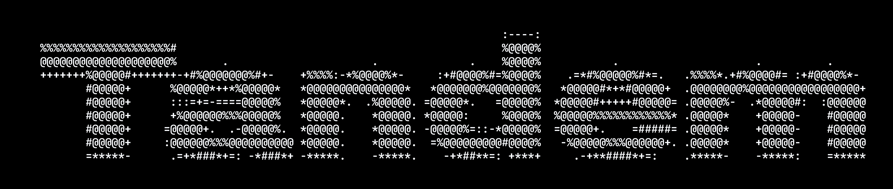

<div align="center">

<picture>
  <source media="(prefers-color-scheme: light)" srcset="logo/tandem-logo-black.png">
  
</picture>

### Your Android phone, as a real second monitor for Linux

Native, low-latency, GPU-accelerated, with touch. Drag a window onto the phone and it appears there.

**[Website](https://saharshbaiju.github.io/tandem/)** · **[Download the app](https://github.com/saharshbaiju/tandem/releases/latest)** · **[Documentation](#documentation)** · **[Architecture](docs/ARCHITECTURE.md)**

</div>

---

Tandem turns an Android phone into a second monitor for a Linux desktop. It is
similar to spacedesk on Windows, but it is native, and the video path uses the GPU
from end to end.

| Desktop | Distributions | How the virtual monitor is made |
| --- | --- | --- |
| **Hyprland** | Arch, and anything else running Hyprland | `hyprctl output create headless`, with wf-recorder and VA-API. On NVIDIA, xdg-desktop-portal-hyprland and GStreamer NVENC, zero copy |
| **GNOME on Wayland** | **Ubuntu 22.04 and newer**, **Fedora 36 and newer**, any GNOME 40 or newer | Mutter's virtual monitor API, PipeWire and GStreamer |

**Touch works too.** Tap, drag, scroll and pinch on the phone to control what is on
it. Touches go through a virtual touchscreen, so your mouse pointer stays where it
is. Only a phone that has scanned the computer's QR code can control the desktop.
Pair by scanning the QR code shown in the terminal. Connect over a **USB cable**
(through adb, automatically when USB debugging is on), **USB tethering** (no USB
debugging needed), or **Wi-Fi**.

**Your monitors stay as they are.** Tandem never modifies your existing monitors:
it adds the phone beside them and only ever changes its own virtual monitor
and, on Hyprland, the one workspace it gives the phone.

## Documentation

- [`docs/PLATFORMS.md`](docs/PLATFORMS.md): install and setup on Arch, Ubuntu and
  Fedora, how the GNOME backend works, and troubleshooting.
- [`docs/ARCHITECTURE.md`](docs/ARCHITECTURE.md): the whole pipeline, the wire
  protocol, the reliability rules, and the latency budget.
- [`docs/ANDROID.md`](docs/ANDROID.md): the phone app, covering the UI, its
  components, the decode path and the developer workflow.
- [`docs/SECURITY.md`](docs/SECURITY.md): who can connect, how encryption works (TLS
  with a pinned certificate), the pairing-key handshake, limits, and how it was
  tested.
- [`docs/RELEASING.md`](docs/RELEASING.md): how releases are built, signed and
  published, as an APK and a Linux tarball on GitHub Releases.
- [`website/`](website/): the landing page. It is one static file with no build
  step. It is published to <https://saharshbaiju.github.io/tandem/> whenever
  `website/` changes on `main`.

## Install

### On the computer (Ubuntu, Fedora, Arch)

```bash
curl -fsSL https://raw.githubusercontent.com/saharshbaiju/tandem/main/install.sh | bash
```

Then open a new terminal and run **`tandem`**.

The installer places the program in `~/.local/share/tandem` and adds the `tandem`
command. If needed, it adds `~/.local/bin` to your shell's PATH. It also creates a
*Tandem* entry in the app menu, and installs the packages your distribution and
desktop need, using `apt`, `dnf` or `pacman`. It asks for your password once.
Run the same line again to update. `./install.sh --uninstall` removes Tandem. From a
git checkout, `./install.sh` installs that checkout instead.

> **Ubuntu and Fedora:** log in to the GNOME **Wayland** session, which is the
> default. On Ubuntu, choose "Ubuntu", not "Ubuntu on Xorg". On Fedora, the H.264
> encoder comes from the `fedora-cisco-openh264` repository, which is enabled by
> default on Workstation.

### On the phone (Android 8 and newer)

Download **`Tandem-<version>.apk`** from the
[latest release](https://github.com/saharshbaiju/tandem/releases/latest) on the
phone, open it, and allow installs from your browser when asked.

> **Previously used *Screen Extender* (amVD 0.4 or older)?** Tandem is a separate
> app with its own package ID, so it installs next to the old one. Uninstall
> *Screen Extender*, then scan the new QR code. The `-debug.apk` is a separate app
> again, called *Tandem (debug)*, for testing.

### Connect

1. Run `tandem`, then choose **Start Tandem**. A QR code appears.
2. Choose how the phone reaches the computer:
   - **USB cable** (lowest latency): turn on *USB debugging* on the phone and plug
     it in. `tandem` sets up `adb reverse` by itself. This works even when the
     phone is on mobile data.
   - **USB tethering**: *Settings → Hotspot & tethering → USB tethering*. No
     developer options are needed.
   - **Wi-Fi**: the phone and the computer are on the same network. If a firewall
     is in the way, the live view says so. Press **f** to open the port. The port
     is 5000, or the next free one if another program already uses 5000. The live
     view shows which one is in use. For the best Wi-Fi, connect the computer
     to the phone's own mobile hotspot. The two then talk directly, with no
     router in between, no other devices competing for airtime and no guest or
     campus network isolating them. The computer reaches the internet through
     the phone's mobile data while it is connected. The video stream itself
     stays on the hotspot link and uses no mobile data.

   While it waits for the phone, the live view shows **connection checks**. They
   cover whether USB debugging is authorised, whether a firewall is blocking the
   port, and whether Wi-Fi is reachable. They explain why a phone cannot connect yet.
3. In the app, tap **Scan QR code**, scan the code in the terminal, and tap
   **Connect**. Ripples spread from your finger, and then the screen dissolves into
   your extended desktop.
4. Touch the phone's screen to use it. On **Hyprland**, touch needs a one-time
   permission for `/dev/uinput`. The installer offers to set it up, or you can press
   **t** in the live view. On **GNOME**, nothing needs to be set up.

The phone's stock camera works too. Point it at the QR code, and it opens a
`tandem://` link in the app, which asks you to confirm the computer.

**Only your phone can connect.** The QR code carries a random pairing key and the
fingerprint of the computer's encryption certificate. Nothing is sent to a phone
until both sides have proved that they know the key. Everything, including video and
touches, is encrypted with TLS. Other devices on the same Wi-Fi can neither watch
the screen nor send touches. To enter an address by hand, also type the **pairing
code** shown under the QR code. Details are in [`docs/SECURITY.md`](docs/SECURITY.md).

Without the terminal UI, `~/.local/share/tandem/linux/start-tandem.sh usb` prints
the same QR code and runs the daemon in the foreground.

## How it works

```
virtual monitor (Hyprland headless output / Mutter virtual monitor)
        │  zero-copy capture
   H.264 encode on the compositor's GPU (NVENC / VA-API, x264 / openh264 fallback;
                GStreamer VA / x264 / openh264 on GNOME)
        │  no B-frames, one slice per frame, CBR with a 2-frame buffer
   tandemd.py   splits NAL units, caches the current GOP, one I/O
        │         thread per phone, 1 s heartbeats, keyframe on request (KEYQ),
        │         restarts the encoder if it exits
   TLS over TCP: USB tethering, Wi-Fi, or adb reverse (every QR address tried
        │         in parallel); pairing-key proof before anything is sent
        │                                        ▲
   Android app → MediaCodec → Surface            │ touches, keyframe requests
                hardware decode, rendered on arrival    (paired phones only)
                                                 │
   phone_input.py → virtual touchscreen: uinput (Hyprland) / Mutter RemoteDesktop (GNOME)
```

Target latency from glass to glass is about **25 to 45 ms** over USB and about
**30 to 60 ms** over Wi-Fi, with hardware encoding. Wi-Fi is lowest on the
phone's own hotspot.

### Why it is fast

The video goes straight from the encoder to the phone's hardware decoder. There is
no media player and no jitter buffer, and the stream is raw H.264 with no container.
The encoder runs on the GPU that the compositor renders on, so frames are never
copied between GPUs. Details are in
[`ARCHITECTURE.md` §2](docs/ARCHITECTURE.md#2-why-the-pipeline-avoids-buffering).

### Why it stays connected

Heartbeats run in both directions. A phone that joins a still desktop receives the
current picture at once, because the daemon replays the last keyframe and the frames
that followed it. The same replay repairs a lost or broken frame: the phone asks for
a keyframe (`KEYQ`) and is back on the live picture within milliseconds. A phone
that falls more than a fraction of a second behind skips the stale frames instead of
playing them late. If the encoder exits, the daemon restarts it while the phone
stays connected. If the link drops after streaming, for example when the cable is pulled,
the Wi-Fi roams, or a setting changes, the app shows *Reconnecting…* over the last
frame and resumes by itself. The reliability rules, and the failures they prevent,
are listed in [`ARCHITECTURE.md` §7](docs/ARCHITECTURE.md#7-failure-modes-and-the-rules-that-prevent-them).

## The terminal UI

```bash
tandem
```

- **Start Tandem** launches the daemon and opens the live view. It shows the status,
  the pairing **QR code**, the plain addresses, the touch status and the daemon log.
  `q` returns to the menu and keeps the stream running. `d` disconnects and removes
  the monitor.
- **Configure** sets the desktop backend (auto, hyprland or gnome), the screen
  **side** (left, right, up or down), the **resolution** (presets, or *Match connected
  phone* through adb), the **FPS**, the desktop **scale**, the **quality** (bitrate),
  the keyframe interval, the **preferred link** (which address comes first in the
  QR code), the **port**, **touch input** (on or off), and **paired phones**. The
  paired phones option has a *forget all* action, which creates a new pairing key.
  Connected phones are dropped, and each one must scan the QR code again. Saving
  while streaming applies side and scale at once. Other changes restart the stream.
  Settings are stored in `~/.config/tandem/config.json`.
- **Dependencies** lists what is needed for your distribution and backend, using
  pacman, apt or dnf. Press `i` to install what is missing.
- **Detected hardware** shows the desktop, the primary monitor, the VA-API node, the
  USB tether link, the phone's panel size (through adb) and the LAN IP.

### The daemon directly (advanced, scripting)

```bash
cd linux
./start-tandem.sh usb|wifi [flags]     # prints the QR, runs in the foreground
python3 tandemd.py --help
```

```
--backend auto|hyprland|gnome            # auto-detected from the session
--width 2400 --height 1080 --fps 60      # virtual monitor mode
--side right|left|up|down --scale 1.5    # placement (applied live on SIGUSR1)
--bitrate 12M --gop 30                   # encoder (Hyprland: GOP is at least 1 s of frames)
--encoder auto|vah264enc|x264enc|…       # GNOME: GStreamer element to use
--encoder auto|h264_nvenc|h264_vaapi|libx264|libopenh264  # Hyprland: compositor GPU, CPU fallback
--device /dev/dri/renderD128             # Hyprland: VA-API node (h264_vaapi)
--host 0.0.0.0 --port 5000               # default: every interface, IPv4 and IPv6
--keep-output                            # Hyprland: keep the monitor when the daemon exits
--parent-pid PID                         # stop, and remove the monitor, when PID exits
--pairing-key-file ~/.config/tandem/pairing-key   # phones must prove this key (default)
--tls-dir ~/.config/tandem/tls                    # TLS certificate (default; created if missing)
--no-touch                               # view only
```

Signals: SIGTERM, SIGINT and SIGHUP stop the daemon cleanly. SIGUSR1 re-reads
`--banner-file` and applies side and scale live.

## The Android app

Most people install the APK from GitHub Releases, as described above. To build it
yourself:

```bash
cd android
JAVA_HOME=/opt/android-studio/jbr ./gradlew :app:assembleDebug
adb install -r app/build/outputs/apk/debug/app-debug.apk
```

You can also open `android/` in Android Studio and press Run. The command-line build
needs JDK 17 to 21. If your system JDK is newer, point `JAVA_HOME` at the JBR that
ships with Android Studio. The app requires Android 8.0 or newer. Its QR scanner uses
Google Play services, so the app needs no camera permission. The theme is OLED black,
matching the website. On Android 13 and newer, the water transition uses a shader. On
older phones, it uses a canvas version.

## Developing

```bash
python3 linux/testsrc.py --width 2400 --height 1080   # fake desktop, real daemon code
python3 linux/testsrc.py --log-touch                  # …and print the touches it receives
adb shell am start -a android.intent.action.VIEW -d "'tandem://c?h=10.0.2.2&p=5000'"   # emulator
adb logcat -s StreamSession
```

`testsrc.py` streams a test pattern through the real broadcaster without creating a
monitor. That lets you develop the app on any machine. The emulator reaches the PC
at `10.0.2.2`. More is in [`ANDROID.md` §7](docs/ANDROID.md#7-developer-install-and-debugging).

## Project layout

```
linux/
  tandem                TUI launcher (installed as the `tandem` command)
  python.sh             picks the system /usr/bin/python3 (not conda/pyenv) for
                        tandem, start-tandem.sh and install.sh
  tui.py                curses UI: deps, detection, config, live view + QR
  core.py               config, distro/dependency detection, addresses, QR URI
  qr.py                 dependency-free QR encoder (half-block terminal output)
  tandemd.py            daemon: backend → NAL parse → GOP cache → TCP broadcast
  secure_link.py        TLS certificate, pairing key, handshake, lock-out
  phone_input.py        what admitted phones send back: touches → slots
  uinput_touch.py       virtual multi-touch touchscreen via /dev/uinput (Hyprland)
  backends/hyprland.py  headless output, hyprctl Lua API, wf-recorder, touch mapping
  backends/xdph.py      NVIDIA: zero-copy capture via the Hyprland portal + GStreamer NVENC
  backends/gnome.py     Mutter ScreenCast virtual monitor, DisplayConfig, GStreamer,
                        RemoteDesktop touch
  start-tandem.sh       no-TUI launcher (prints the QR)
  testsrc.py            test-pattern server for app development
  about.py              the credit line and license notice (printed by --version)
android/app/src/main/java/io/github/saharshbaiju/tandem/
  MainActivity.kt       Material 3 UI, scanner, transitions, side sheet
  StreamSession.kt      parallel connect, framed reader, MediaCodec → Surface
  RippleRevealLayout.kt water ripple and reveal (AGSL)
  ConnectTarget.kt      tandem:// QR and deep-link parsing (pairing key, cert fingerprint)
  SecureChannel.kt      TLS, certificate pinning and the pairing proof
  FrameReader.kt        NALU / ASX1 / PING / INPT framing
  FrameWriter.kt        HELO / AUTH / TUCH (phone to computer)
  TouchForwarder.kt     MotionEvent → touch frames
  AspectRatioSurfaceView.kt  letterboxing
LICENSE, NOTICE          GPL-3.0 and its additional terms (see License below)
docs/                    PLATFORMS, ARCHITECTURE, ANDROID, SECURITY, RELEASING
install.sh               one-line installer (any distribution), adds the `tandem` command
```

## Roadmap

- RTP over UDP with forward error correction for lossy Wi-Fi (TCP stays for USB)
- HEVC decoding in the app
- A KDE Plasma backend
- Pen input with pressure and hover, and typing from the phone
- A latency overlay

## License

Tandem is free software under the [GNU GPL version 3](LICENSE), with three
additional terms allowed by its section 7. They are written out in [NOTICE](NOTICE):

- **Keep the credit.** The app's connect screen and `tandem --version` /
  `tandemd.py --version` show *Tandem by Saharsh Baiju ·
  github.com/saharshbaiju/tandem*. Copies and modified versions must keep that
  notice, and they may add their own names next to it.
- **Use your own name.** A distributed fork must not call itself Tandem, or suggest
  that it is the original.
- **Google Play services is allowed.** The Android app's QR scanner comes from
  Google Play services, which is not free software. Linking with it is permitted.

Copyright (C) 2026 Saharsh Baiju.
